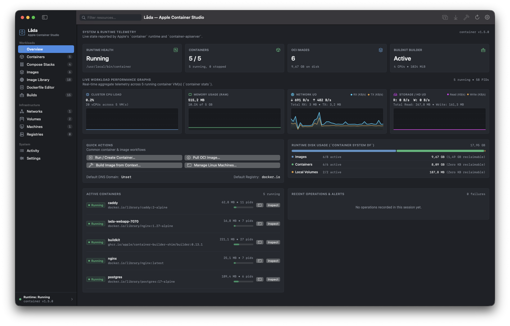
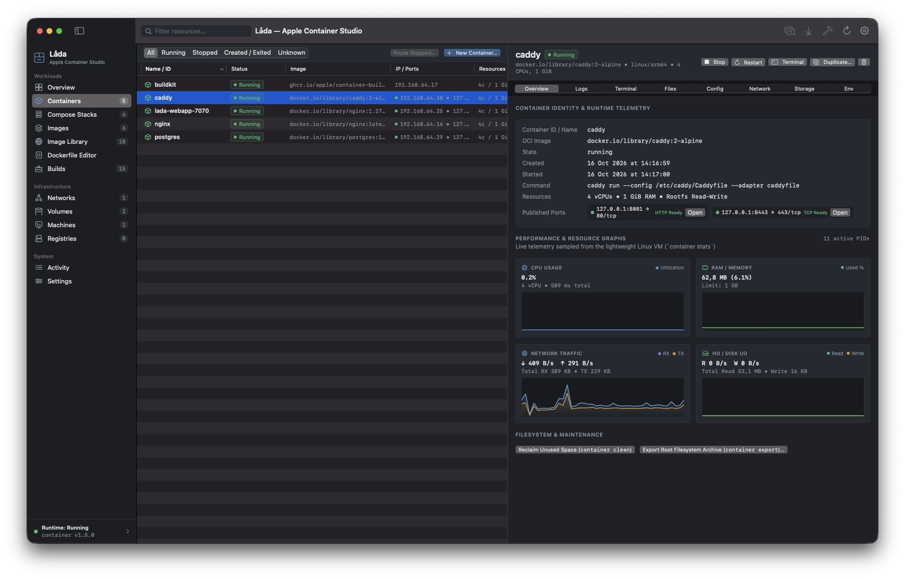
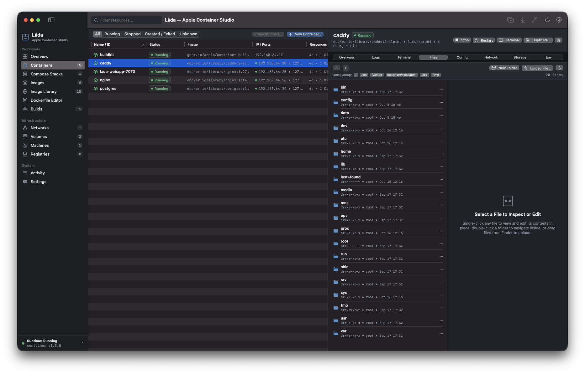
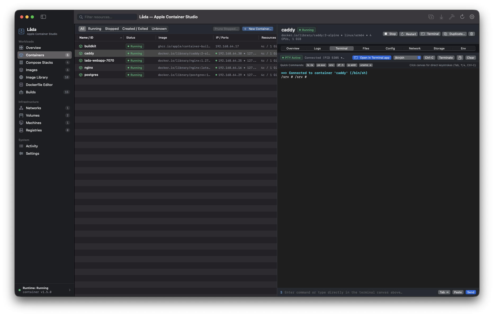
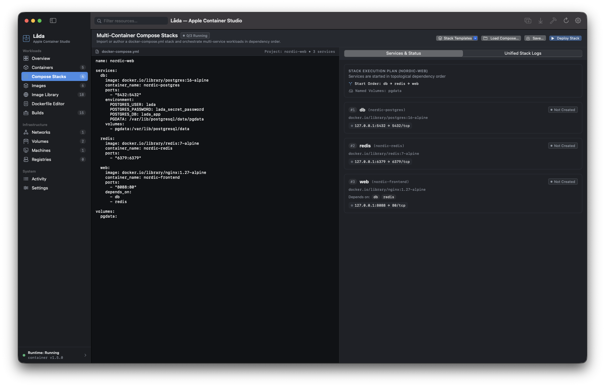
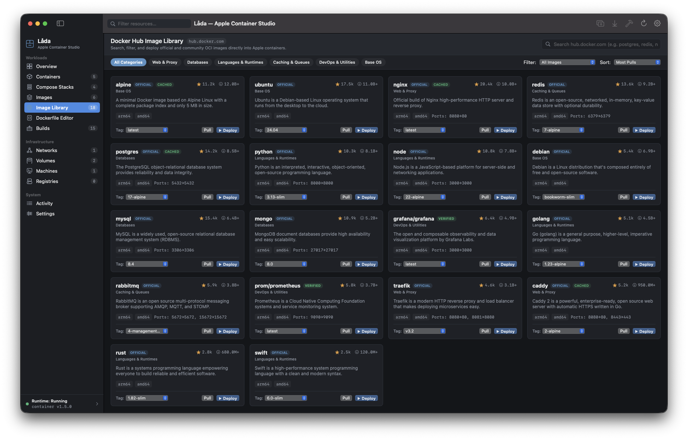
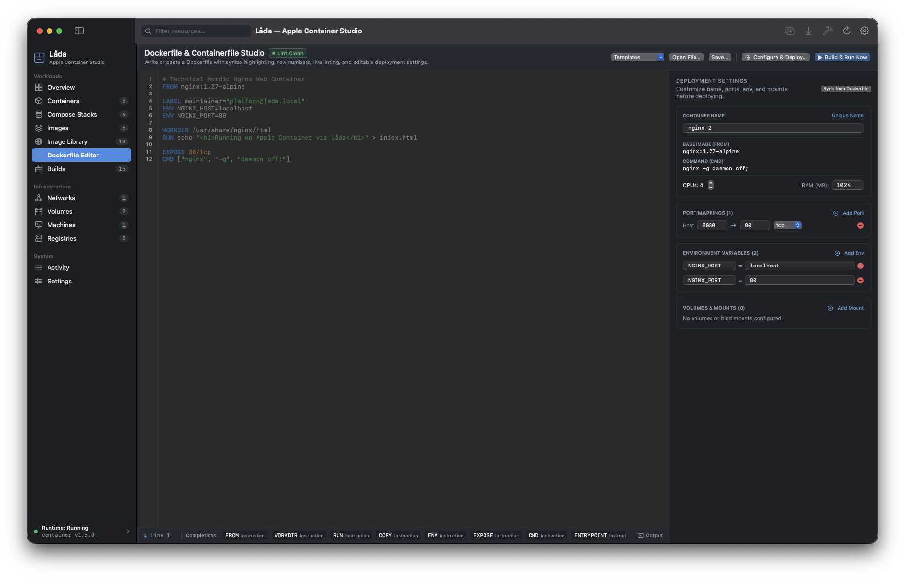

# Låda (`Lada`) — Native macOS GUI for Apple Containers

[](LICENSE)
[](#prerequisites)
[](#building-testing-and-packaging)

**Låda** (Swedish for *"box"* or *"crate"*) is a native macOS desktop application written in Swift and SwiftUI for managing Apple's official [`container`](https://github.com/apple/container) runtime (`v1.5.0+`).

Designed with a **Technical Nordic** visual identity, Låda exposes Apple's lightweight Linux VM-per-container architecture (`Virtualization.framework`, `vmnet`, `virtiofs`, and `container-apiserver`) with real-time telemetry, multi-container Compose stacks, an in-container file browser & editor, an interactive ANSI PTY terminal, a Docker Hub Image Library, and a live Dockerfile Studio — without modifying or replacing Apple's upstream binaries or data directories.



---

## Key Features

### 1. System Overview & Real-Time Telemetry
- **Aggregated Runtime Telemetry Charts**: Live area and line graphs for CPU utilization (`%`), memory usage (`MiB` / `GiB`), network RX/TX throughput, and block I/O across all running Linux micro-VMs.
- **Storage Allocation Breakdown**: Visual progress bars and disk footprint cards for OCI images, active containers, and ext4 sparse volumes (`container system df`).
- **Adaptive Event-Driven Polling**: Automatically switches between high-frequency batched telemetry when the window is active and low-power idle polling when backgrounded or when all containers are stopped.

### 2. Container Management & Live Port Health Probes


- **7-Tab Container Inspector**: Inspect **Overview**, **Files**, **Logs**, **Terminal**, **Inspect**, **Networking**, and **Mounts** for any container.
- **Live Port-Forwarding & HTTP/TCP Health Probes**: Published host ports (`127.0.0.1:<host> -> <container>/tcp`) are continuously probed in the background and badged with live **`HTTP Ready`**, **`TCP Ready`**, or **`Unreachable`** indicators and 1-click browser launch buttons.
- **Diagnostic Crash & Boot Inspector**: Automatically captures both standard container output (`container logs`) and Linux micro-VM boot diagnostics (`container logs --boot`) whenever a container exits unexpectedly.
- **1-Click Native Terminal.app Launch**: Open any running container directly in macOS `Terminal.app` (`container exec -it <id> /bin/sh`) from the container table, inspector header, or right-click context menu.

### 3. In-Container File Browser & Editor (`Files` Tab)


- **Agentless Filesystem Navigation**: Browse directories inside any running container VM with breadcrumb navigation, Quick Jump shortcuts (`/`, `/etc`, `/var/log`, `/app`, `/usr/share/nginx/html`, `/tmp`), permissions, ownership, and file sizes.
- **Built-In Config & Source Editor**: View and edit configuration files (`nginx.conf`, `Caddyfile`, `.env`, scripts, HTML/JSON) directly inside the running container and save changes atomically without installing `vim` or `nano`.
- **Host Import & Export**: Upload files from macOS into a running container or export container files/directories back to the host.

### 4. Interactive ANSI PTY Terminal (`Terminal` Tab)


- **Direct Keystroke Capture (`InteractivePTYCanvas`)**: Type directly into the terminal canvas with support for `Tab` completion, arrow-key command history, `Ctrl+C`, `Ctrl+D`, `Ctrl+L`, and `⌘V` clipboard paste.
- **ANSI Color & Control Sequence Rendering**: Full 16/256-color SGR rendering, cursor backspace handling, and screen clearing backed by a native POSIX pseudo-terminal (`openpty`).
- **Quick Diagnostic Bar**: 1-click chips for `ls -la`, `ps aux`, `env | sort`, `df -h`, `ip addr`, and `cat /etc/os-release`.

### 5. Multi-Container Compose Stacks (`docker-compose.yml`)


- **Compose Stack Orchestration**: Parse and run multi-container `docker-compose.yml` / `compose.yaml` workflows natively on Apple's `container` runtime.
- **Topological Dependency Plan**: Automatically resolves `depends_on` service ordering, provisions isolated `vmnet` stack networks and named volumes, and injects peer service discovery environment variables and `--add-host` entries.
- **Built-in Stack Templates**: Includes ready-to-run templates for **WordPress + MariaDB**, **Node.js API + Redis + Postgres**, and **Prometheus + Grafana**.

### 6. Docker Hub Image Library & Curated Presets


- **Live Docker Hub Search & Curated Catalog**: Search official and community OCI images or browse curated presets across Web Servers, Databases, Caching & Queues, Dev Runtimes, Base OS, and DevOps tools.
- **Apple `container` VM Compatibility Tuning**: Automatically configures `PGDATA`, `MYSQL_DATADIR`, or subdirectory mounts for database images (`postgres`, `mysql`, `mariadb`, `mongo`) so ext4 volume root `lost+found` directories never block database initialization, and automatically detaches TTY allocation (`-i`/`-t`) for background servers like `caddy` where required.

### 7. Dockerfile & Containerfile Studio + Live Linter


- **Syntax-Highlighted Editor & Starter Templates**: Author `Dockerfile` / `Containerfile` definitions with starter templates for **Static Web Server**, **Node.js Express**, **Python FastAPI**, **Go Multi-Stage (`arm64`)**, and **PostgreSQL 17 (Apple Container Ext4 Tuned)**.
- **Live Linter with 1-Click Quick Fixes**: Detects `:latest` floating tags, consecutive `RUN` layers, `apt-get` cache bloat, missing `WORKDIR` paths, and `ADD` vs `COPY` best practices with instant **Apply Fix** actions.
- **Conflict-Free Deployment Controls**: Customize container name, image tag, host/container port mappings, and volume mounts directly in the studio with live port-conflict warnings before building and running.
- **Universal Window Drag-and-Drop**: Drop a `Dockerfile`, `Containerfile`, `docker-compose.yml`, or project folder anywhere onto the Låda window to open and configure it immediately.

### 8. Menu Bar Quick-Control Popover
- Always-available macOS menu bar extra (`MenuBarExtra`) displaying runtime status, active container counts, live CPU/RAM usage, published port quick-links, and 1-click Start/Stop/Terminal controls.

---

## Upstream Runtime Compatibility (`apple/container` v1.5.0)

| Capability | Upstream `container` 1.5.0 CLI / Service | Låda Support Status |
|---|---|---|
| **Host Baseline** | Apple silicon (`arm64`) + macOS 26+ | **Supported** — Verified by `RuntimeDiscoveryService` & `RuntimeHealthService` |
| **System Lifecycle** | `container system start \| stop \| status \| version \| df \| logs \| property \| dns \| kernel` | **Supported** — Dashboard, Setup Wizard, Menu Bar Popover, and Settings → System & Runtime |
| **Container Lifecycle** | `container run \| create \| start \| stop \| restart \| kill \| delete \| prune \| ls \| inspect \| logs \| stats \| exec \| export` | **Supported** — Full table/grid, 5-step creation wizard, 7-tab inspector, live command preview |
| **In-Container File Browser** | `container exec` streaming POSIX file operations | **Supported** — Native directory browser, in-place text editor, and host import/export |
| **Multi-Container Stacks** | `docker-compose.yml` / `compose.yaml` orchestration | **Supported** — Topological service ordering, shared `vmnet` stack network, peer host injection |
| **Interactive Terminal** | `container exec -i -t <id> <shell>` | **Supported** — Native POSIX pseudo-terminal (`openpty`) + ANSI PTY canvas & macOS `Terminal.app` launcher |
| **OCI Images & Docker Hub** | `container image list \| inspect \| pull \| push \| tag \| delete \| prune \| save \| load` | **Supported** — Multi-platform variant inspection, layer history, tar archive save/load, Docker Hub catalog |
| **Image Builds & Studio** | `container build` + `container builder status \| start \| stop \| delete` | **Supported** — Live streaming BuildKit output, Dockerfile Studio with live linter, Builder VM controls |
| **Virtual Networks (`vmnet`)** | `container network list \| create \| inspect \| delete \| prune` | **Supported** — Isolated NAT networks, IPv4/IPv6 CIDR validation, attached container topology |
| **Named Volumes & VirtioFS** | `container volume list \| create \| inspect \| delete \| prune` | **Supported** — Ext4 sparse volume sizing (`-s`), journal mode (`ordered`, `writeback`, `journal`), Finder reveal |
| **Container Machines** | `container machine list \| create \| inspect \| start \| stop \| delete \| set \| default \| logs \| run \| ssh` | **Supported** — Full lifecycle, CPU/RAM/Home-Mount (`rw`/`ro`/`none`) reconfiguration, console logs |
| **OCI Registries** | `container registry login --password-stdin \| logout \| list` | **Supported** — macOS Keychain (`Security.framework`) credential storage + stdin piping (never passed in CLI argv) |
| **Nested Virtualization** | `--virtualization` (`CONFIG_KVM=y` on Apple silicon M3+) | **Supported (Hardware-Gated)** — Automatically enabled on M3/M4/M5 chips; explained when unavailable |
| **Path Masking** | `--masked-path`, `--read-only-path` | **Experimental** — Clearly badged as experimental in `container` 1.5.0 |
| **Restart Policies** | `--restart` | **Unsupported by Upstream** — Explicitly flagged in UI and blocked by `ValidationUtils` so policies are never silently ignored |

---

## Project Architecture

```text
Lada/
├── App/
│   ├── LadaApp.swift                      # SwiftUI @main entry point, MenuBarExtra, keyboard shortcuts
│   ├── AppDelegate.swift                  # Window lifecycle, dock menu, quit behavior
│   ├── AppState.swift                     # @MainActor state coordinator, adaptive polling & drag-and-drop
│   └── MainWindowView.swift               # NavigationSplitView shell, global drop overlay, status bar
├── Core/
│   ├── Models/                            # Typed models & deterministic CLI argument builders
│   ├── Errors/LadaError.swift             # Structured error taxonomy & actionable remediation
│   ├── Utilities/
│   │   ├── ComposeParser.swift            # Multi-container docker-compose.yml parser & topological planner
│   │   ├── DockerfileParser.swift         # Dockerfile / Containerfile parser & auto-configuration builder
│   │   ├── PortHealthProber.swift         # Live TCP & HTTP port reachability prober
│   │   ├── SecretRedactor.swift           # Automatic secret/token masking for logs & CLI previews
│   │   ├── StructuredLogger.swift         # Privacy-aware ring buffer + os.Logger
│   │   ├── KeychainService.swift          # macOS Keychain & in-memory test credential stores
│   │   └── ValidationUtils.swift          # Upstream-aligned naming, CIDR, MAC, and port validators
│   └── Configuration/
│       └── AppPreferences.swift           # UserDefaults-backed app settings (separate from runtime config)
├── Runtime/
│   ├── CommandRunner.swift                # Non-shell Process actor with stdout/stderr streaming & cancellation
│   ├── ContainerRuntimeService.swift      # Service protocol for live & mock implementations
│   ├── ContainerCLIClient.swift           # Live integration with Apple's `container` CLI
│   ├── DockerHubService.swift             # Curated OCI catalog & live Docker Hub search API client
│   ├── MockContainerRuntimeService.swift  # Deterministic simulation service for tests & sandbox preview
│   ├── RuntimeDiscoveryService.swift      # Hardware/OS sysctl checks & CLI binary discovery
│   ├── RuntimeHealthService.swift         # 10-point prerequisite evaluator + HTTPS/SHA-256/pkgutil verifier
│   ├── RuntimeCapabilities.swift          # Feature-capability matrix evaluator
│   └── OutputParsers/
│       └── ContainerOutputParser.swift    # JSON/text parsers for all `container` subcommands
├── Features/
│   ├── Setup/SetupWizardView.swift
│   ├── Dashboard/DashboardView.swift      # System overview, telemetry charts, runtime health cards
│   ├── Containers/
│   │   ├── ContainersView.swift           # Container table/grid, port probe pills, quick actions
│   │   ├── ContainerDetailView.swift      # 7-tab container inspector
│   │   ├── ContainerFileBrowserView.swift # In-container file browser, viewer/editor & host import/export
│   │   └── CreateContainerWizardView.swift
│   ├── Stacks/StacksView.swift            # Multi-container Compose Stacks manager & YAML editor
│   ├── Terminal/InteractiveTerminalView.swift # Native POSIX PTY + direct-keystroke ANSI terminal canvas
│   ├── Images/ImagesView.swift            # Local OCI image manager & layer inspector
│   ├── ImageLibrary/ImageLibraryView.swift # Docker Hub search & 1-click preset deployment
│   ├── Editor/DockerfileEditorView.swift  # Dockerfile Studio, live linter & 1-click build/run
│   ├── Builds/BuildsView.swift            # BuildKit job monitor & Builder VM controls
│   ├── Networks/NetworksView.swift        # vmnet virtual network manager
│   ├── Volumes/VolumesView.swift          # Ext4 sparse volume & VirtioFS manager
│   ├── Machines/MachinesView.swift        # Linux container machine lifecycle & resource controls
│   ├── Registry/RegistriesView.swift      # OCI registry authentication manager
│   ├── MenuBar/MenuBarPopoverView.swift   # macOS menu bar quick-control popover
│   └── Settings/SettingsView.swift        # Activity log + 8-section Settings
├── Shared/
│   ├── DesignSystem/NordicTheme.swift
│   ├── Icons/LadaIcons.swift              # Custom 1.5pt geometric SwiftUI Shape vector icons
│   ├── Components/ReusableComponents.swift
│   └── Accessibility/AccessibilityIdentifiers.swift
├── Resources/
│   ├── AppIcon.icns
│   ├── Info.plist
│   └── Lada.entitlements
└── Tests/
    ├── UnitTests/
    ├── IntegrationTests/
    └── UIAutomationTests/
```

---

## Building, Testing, and Packaging

### Prerequisites
- **macOS 15.0+** to build and run the Låda application UI (`macOS 26+` on Apple silicon required by Apple's `container` runtime for live Linux micro-VM execution).
- **Swift 6.0+** / **Xcode 16+**.
- Apple's [`container`](https://github.com/apple/container) CLI installed at `/usr/local/bin/container` or `/opt/homebrew/bin/container` (Låda also includes a built-in Setup Wizard and Mock Sandbox mode).

### Build & Run via SwiftPM
```bash
swift build
swift run Lada
```

### Run Automated Test Suites
```bash
swift test
```

### Package Native `Lada.app` Bundle & `.dmg`
```bash
chmod +x Scripts/package-app.sh
./Scripts/package-app.sh
open "build/Lada.app"
```

---

## License

This project is licensed under the **MIT License** — see the [LICENSE](LICENSE) file for details.
