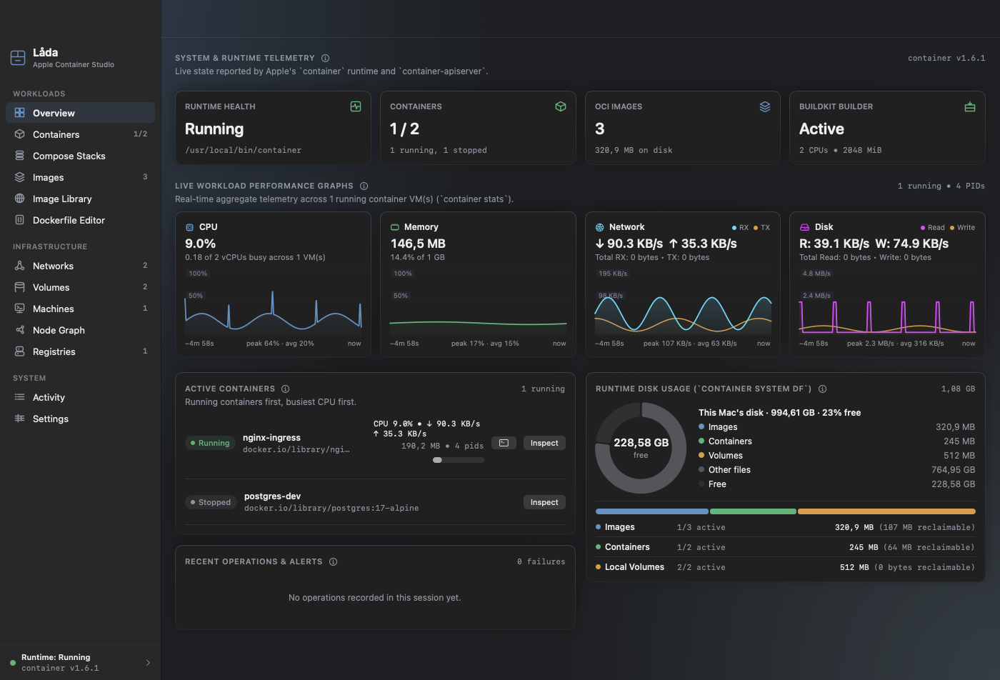
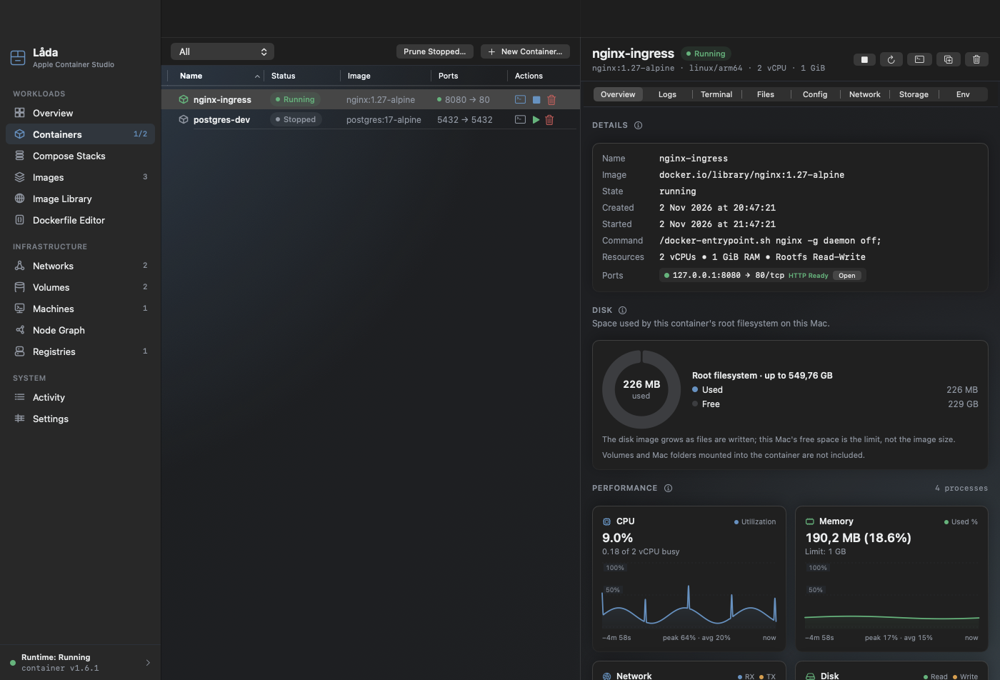
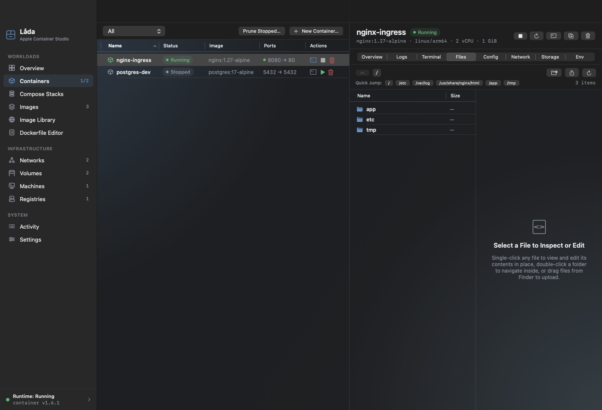
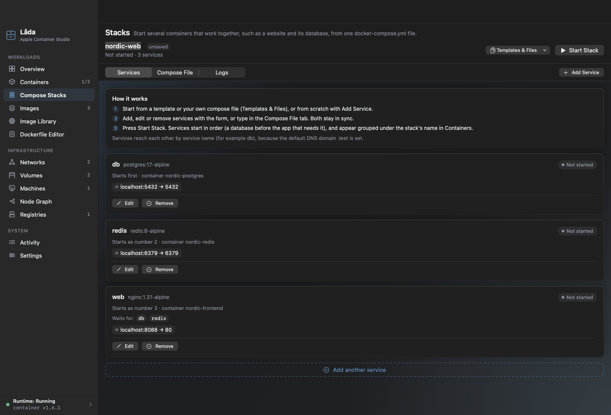
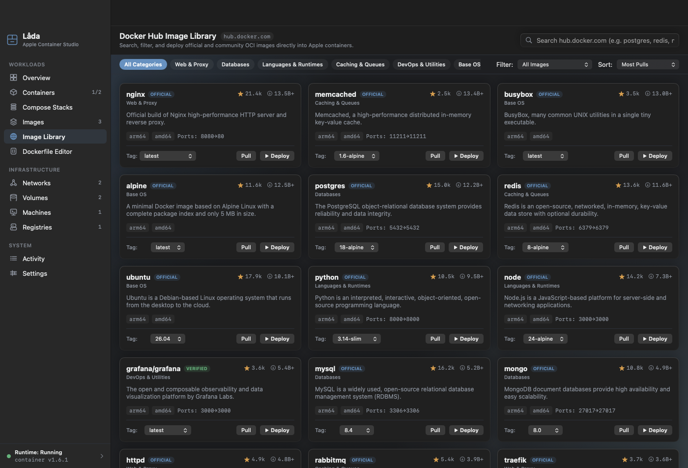
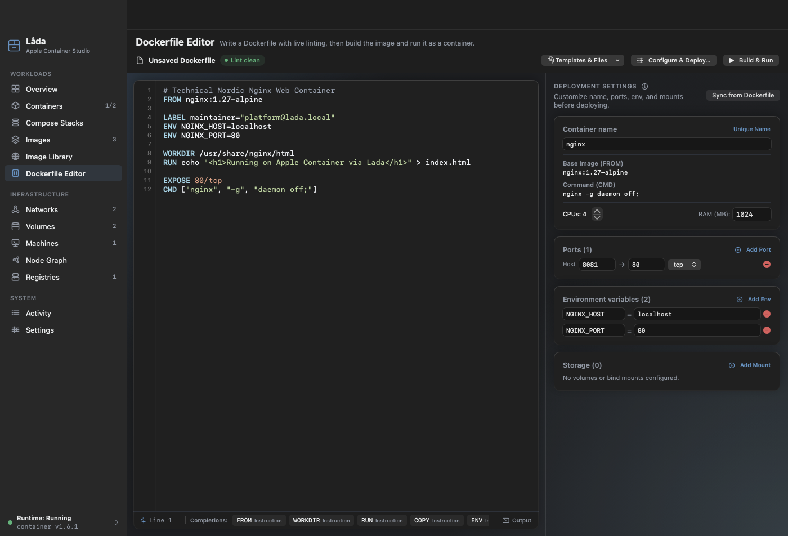
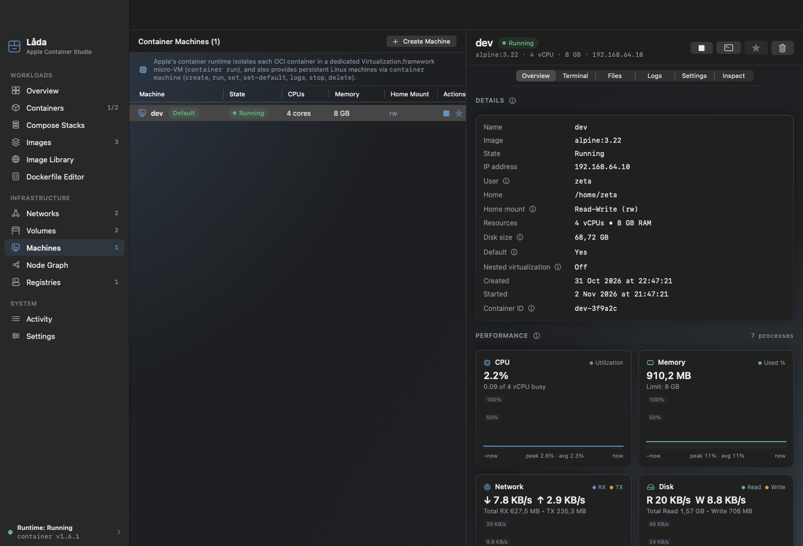
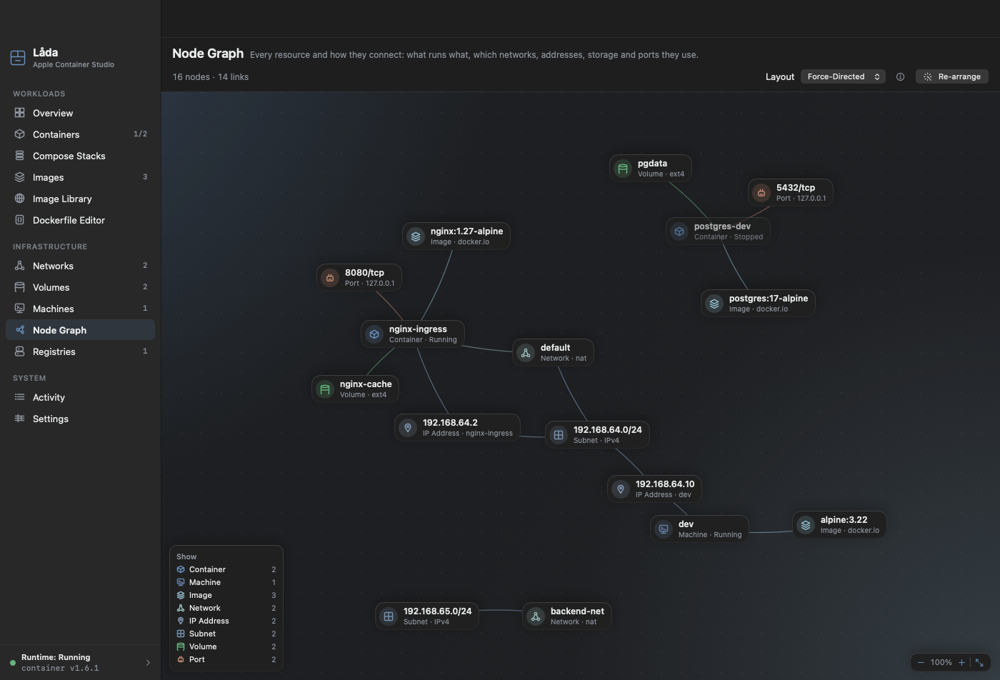

# Låda (`Lada`) — Native macOS GUI for Apple Containers

[](LICENSE)
[](#prerequisites)
[](#building-testing-and-packaging)

**Låda** (Swedish for *"box"* or *"crate"*) is a native macOS desktop application written in Swift and SwiftUI for managing Apple's official [`container`](https://github.com/apple/container) runtime (`v1.5.0+`; tested against `v1.6.1`).

Designed with a **Nordic frosted-glass** look (translucent window, glass panels, custom vector icons), Låda exposes Apple's lightweight Linux VM-per-container architecture (`Virtualization.framework`, `vmnet`, `virtiofs`, and `container-apiserver`) with real-time telemetry, multi-container Compose stacks, an in-container file browser & editor, an interactive PTY terminal, a Docker Hub Image Library, and a Dockerfile Editor with code completion — without modifying or replacing Apple's upstream binaries or data directories.



---

## Key Features

### 1. Overview Dashboard
- **Live Telemetry Charts**: CPU (weighted by each container's vCPUs), memory, network RX/TX and block I/O across all running containers, with a 5-minute history, hover readouts and peak/average.
- **Disk Space Donut**: This Mac's disk split into images, containers, volumes, other files and free space, next to the `container system df` breakdown with reclaimable space.
- **Packed Panel Layout**: Active Containers (busiest first), disk usage and recent operations pack into columns without gaps and reflow to one column in a narrow window.
- **One Poll Loop**: Containers, stats and port health are refreshed every 2 seconds while Låda is the active app (pausing when it is in the background), and views only redraw when a value actually changed.

### 2. Containers & Live Port Health


- **Container Table with Stack Groups**: Containers started from a stack are grouped under the stack's name in a collapsible row, with Start All / Stop All and Open in Stacks.
- **8-Tab Inspector**: **Overview**, **Logs**, **Terminal**, **Files**, **Config**, **Network**, **Storage** and **Env**. Each container keeps its own tab, terminal session, folder and logs when you switch containers or sections.
- **Per-Container Disk Donut**: How much space the container's root filesystem image really uses on this Mac, and how much it can still grow (the smaller of the image's size and the Mac's free space). It is measured from the sparse `rootfs.ext4`, so it works for stopped containers too.
- **Live Port Health Probes**: Published ports are probed in the background and badged **HTTP Ready**, **TCP Ready** or **Unreachable**, with an Open button for HTTP.
- **Crash Diagnostics**: When a container exits right after starting, Låda shows its output (`container logs`) and the VM boot log (`container logs --boot`).
- **Terminal.app Launch**: Open a running container's shell in macOS Terminal (`container exec -it <id> <shell>`).

### 3. In-Container File Browser & Editor (`Files` Tab)


- **Agentless Browsing**: Breadcrumbs, Quick Jump (`/`, `/etc`, `/var/log`, `/usr/share/nginx/html`, `/app`, `/tmp`), permissions, owners and sizes, using `container exec` (no shell) and `container copy`.
- **In-Place Editor**: Edit text files up to 1 MiB inside the running container; saving keeps the file's mode and owner. Binary and larger files are refused rather than truncated.
- **Upload & Download**: Byte-exact transfers between your Mac and the container, including drag and drop from Finder.

### 4. Interactive Terminal (`Terminal` Tab)
- **Real Terminal**: A native POSIX pseudo-terminal (`openpty`) running `container exec -it`, rendered by Låda's own VT100/xterm screen model: 16/256-colour and true-colour SGR, cursor movement, alternate screen (`vim`, `top`, `less`), scrollback and xterm key encoding.
- **Sessions Stay Open**: Each container keeps its session while you switch containers or sections.

### 5. Stacks (`docker-compose.yml`)


- **Starts Empty**: Build a stack yourself or start from a template. After a stack starts successfully, the screen clears and the stack lives on in Containers (Open in Stacks reopens its compose file).
- **Two-Way Stack Builder**: Add or edit services with a form (image with autocomplete or an Image Library preset, ports, settings, storage, start order) or type in the Compose File tab. Both stay in sync, and only the affected service is rewritten, so your comments are kept.
- **Dependency Order & DNS Aliases**: `depends_on` decides the start order, named volumes are created, and each service gets its name (plus Compose `aliases:`) as a DNS alias on the `default` network, so peers reach it as e.g. `db`. Single-label names need a default DNS domain (`container system dns create test`, then `container system property set dns.domain test`); without one the stack log says which aliases were skipped.
- **25 Templates**: Website + PostgreSQL + Redis, WordPress + MySQL, LAMP (PHP + MariaDB + phpMyAdmin), Ghost + MySQL, Nextcloud + PostgreSQL + Redis, Drupal, Joomla, MediaWiki, Directus, Keycloak, n8n, Matomo, Metabase, Odoo, MongoDB + Mongo Express, PostgreSQL + Adminer, Gitea + PostgreSQL, Prometheus + Grafana, Uptime Kuma, Python API + Redis, NATS + Valkey, RabbitMQ, Caddy reverse proxy, Mailpit + private registry, and Vault (dev mode). Images are pinned to arm64 builds and passwords are generated per use. Apps that reach their database by service name (`db`) need the default DNS domain described above; without it they stop when they can't connect. Open and save any `.yml`/`.yaml` compose file, with recent files.

### 6. Docker Hub Image Library


- **Search & Curated Catalog**: Search Docker Hub or browse 35 curated presets across web servers, databases, caching & queues, languages & runtimes, base OS images and DevOps tools.
- **Tuned for Apple `container`**: Database presets use a data subdirectory so the volume's `lost+found` never blocks initialisation, and database passwords are generated at deploy time. Presets start detached without `-i` (which `container run -d -i -t` rejects from a non-terminal), shell images get a TTY so they keep running, and runtimes without a long-running default idle for use from the Terminal tab. Every preset tag has an arm64 build, and all presets were verified to start on `container` 1.6.1.

### 7. Dockerfile Editor


- **IntelliSense**: beside the completion list, a reference for the highlighted suggestion: what the instruction does, how it works, its syntax, every parameter and flag (the one you're typing highlighted) and an example.
- **Code Completion While You Type**: Suggestions follow the cursor's context: instructions at the start of a line, then each instruction's arguments. That includes images on this Mac and from the library after `FROM`, build stages after `COPY --from=`, `ARG`/`ENV` names after `$`, flags (`--mount=type=cache`, `--chown=`, `--platform=`), ports, signals, earlier `WORKDIR`s and `USER`s, and OCI labels.
- **Syntax Highlighting**: Nordic palette tuned for light and dark mode, on the same glass as the rest of the app, with line numbers.
- **Starter Templates**: Nginx static site, Python HTTP service, Node.js 22, Swift 6, Go 1.23 and PostgreSQL 16 (ext4-tuned).
- **Live Linter with Quick Fixes**: Unpinned base image tags, `COPY`/`ADD` before `WORKDIR`, `apt-get install` without `-y`, PostgreSQL without a `PGDATA` subdirectory, and no `EXPOSE`.
- **Build & Run**: Edit the container name, ports, environment, storage, CPUs and memory with live name and port conflict checks, then build with live BuildKit output and run, or open the settings in the Create Container wizard.
- **Drag and Drop**: Drop a `Dockerfile`, `Containerfile`, `docker-compose.yml` or project folder anywhere on the window.

### 8. Machines


- **Machine Inspector**: like a container's, with **Overview** (details from `machine inspect`, live CPU, memory, network and disk charts, Run a Command), **Terminal** (the machine's real login shell as your user, via `container machine run -i -t`), **Files** (browse, edit, upload and download through the machine's container), **Logs** (machine or boot log), **Settings** (CPUs, memory, home-folder sharing, nested virtualization; save, or save and restart) and **Inspect** (raw JSON).
- **Open in Terminal.app** for a full native terminal, and state kept per machine when you switch.

### 9. Node Graph


- **Every Resource on One Canvas**: stacks, containers, machines, images, networks, IP addresses, subnets, volumes, Mac folders, ports and registries, each with its own icon and colour.
- **Relationships**: *runs* (image), *attached to* (network), *has address* and *in subnet*, *mounts* (volume or Mac folder), *publishes* (port), *member of* (stack), *pulled from* (registry), and *same repository* for containers built from different tags of one image.
- **Layouts**: Force-Directed (Fruchterman–Reingold), Hierarchy (Sugiyama-style layers with crossing reduction), Radial (rings by distance from the selected node), Circular and By Type; overlapping nodes are always pushed apart.
- **Interactive**: drag nodes (they keep their place), pan and zoom, hide resource types, hover for a node's configuration, and double-click to open it.

### 10. Universal Search, Info Tips and Settings
- **Search Everything** from the toolbar: containers, stacks, images, machines, volumes, networks, registries, Image Library presets and pages, each with its type, where it lives and its state. ↑↓ to move, Return to open.
- **ⓘ Info Tips**: hover cards explain sections, settings and form fields across the app.
- **Create Sheets**: networks, volumes, machines and registry logins share one layout with live validation (duplicate names, overlapping subnets, sizes vs. free space), a command preview and plain-language hints.
- **Appearance**: ten accent themes shown as swatches, light/dark/system, and an Interface Density setting (Compact: smaller controls, tighter panels and rows).
- **About**: version, runtime and Mac details with Copy Version Info.

### 11. Menu Bar Popover
- A `MenuBarExtra` with runtime status, running containers with live CPU and memory, and one-click Open in Browser, Terminal, Start and Stop, plus New Container and Stacks.

---

## Upstream Runtime Compatibility (`apple/container` v1.6.1)

| Capability | Upstream `container` 1.6.1 CLI / Service | Låda Support Status |
|---|---|---|
| **Host Baseline** | Apple silicon (`arm64`) + macOS 26+ | **Supported** — Verified by `RuntimeDiscoveryService` & `RuntimeHealthService` |
| **System Lifecycle** | `container system start \| stop \| status \| version \| df \| logs \| property \| dns \| kernel` | **Supported** — Dashboard, Setup Wizard, Menu Bar Popover, and Settings → System & Runtime |
| **Container Lifecycle** | `container run \| create \| start \| stop \| kill \| delete \| clean \| prune \| ls \| inspect \| logs \| stats \| exec \| export` (Låda's Restart is `stop` + `start`; upstream has no `restart`) | **Supported** — Container table with stack groups, creation wizard, 8-tab inspector, live command preview |
| **In-Container File Browser** | `container copy` for transfers; `container exec` (no shell) for `ls`, `mkdir`, `rm`, `stat` | **Supported** — Directory browser, editor for text files up to 1 MiB (keeps mode and owner on save), byte-exact upload and download |
| **Multi-Container Stacks** | `docker-compose.yml` / `compose.yaml` orchestration | **Supported** — Topological service ordering, named volumes, service names as DNS aliases on the `default` network (needs a default DNS domain for single-label names) |
| **DNS Aliases** | `--network <name>,alias=<name>` (1.6.0+) | **Supported** — Create Container wizard (validated against upstream rules), Networking tab, Compose `aliases:` |
| **Interactive Terminal** | `container exec -i -t <id> <shell>` | **Supported** — Native POSIX pseudo-terminal (`openpty`) with an xterm-compatible screen model, and a macOS `Terminal.app` launcher |
| **OCI Images & Docker Hub** | `container image list \| inspect \| pull \| push \| tag \| delete \| prune \| save \| load` | **Supported** — Multi-platform variant inspection, layer history, tar archive save/load, Docker Hub catalog |
| **Image Builds** | `container build`, `container builder status \| stop` | **Supported** — In the Dockerfile Editor: code completion, linter, live BuildKit output, build and run |
| **Virtual Networks (`vmnet`)** | `container network list \| create \| inspect \| delete \| prune` | **Supported** — Isolated NAT networks, IPv4/IPv6 CIDR validation, attached container topology |
| **Named Volumes & VirtioFS** | `container volume list \| create \| inspect \| delete \| prune` | **Supported** — Ext4 sparse volume sizing (`-s`), journal mode (`ordered`, `writeback`, `journal`), Finder reveal |
| **Container Machines** | `container machine list \| create \| inspect \| stop \| delete \| set \| set-default \| logs \| run` (start = `machine run … true`); `machine.*` defaults from `system property list`; `stats`, `exec` and `copy` on the machine's `containerId` | **Supported** — Inspector with live charts, login-shell terminal, file browser, logs, settings (save and restart), Terminal.app |
| **OCI Registries** | `container registry login --password-stdin \| logout \| list` | **Supported** — macOS Keychain (`Security.framework`) credential storage + stdin piping (never passed in CLI argv) |
| **Nested Virtualization** | `--virtualization` (`CONFIG_KVM=y` on Apple silicon M3+) | **Supported (Hardware-Gated)** — Automatically enabled on M3/M4/M5 chips; explained when unavailable |
| **Path Masking** | `--masked-path`, `--read-only-path` | **Experimental** — Clearly badged as experimental in `container` 1.6.1 |
| **Runtime Health** | `container system status`, `system version` | **Supported** — Flags a CLI/API-server version mismatch (e.g. after upgrading without restarting services) with a Restart Services action, and runtimes older than 1.6.0 for GHSA-vgrw-36j7-r93w and GHSA-fqxg-rrf3-358v |
| **Kubernetes Clusters** | `container cluster create \| list \| delete \| load-image \| write-config` (experimental, 1.6.1) | **Not yet supported** |
| **Commit** | `container commit <id> <reference>` (1.6.0+) | **Not yet supported** |
| **Restart Policies** | `--restart` | **Unsupported by Upstream** — Explicitly flagged in UI and blocked by `ValidationUtils` so policies are never silently ignored |

---

## Project Architecture

```text
Lada/
├── App/
│   ├── LadaApp.swift                      # SwiftUI @main entry point, MenuBarExtra, keyboard shortcuts
│   ├── AppDelegate.swift                  # Window lifecycle, dock menu, quit behavior
│   ├── AppState.swift                     # @MainActor state coordinator, single poll loop & drag-and-drop
│   ├── ContainerWorkspaces.swift          # Per-container inspector state (tab, terminal, files, logs)
│   ├── StackWorkspace.swift               # The Stacks screen's compose file and deploy state
│   ├── UniversalSearchPanel.swift         # Toolbar search results panel
│   ├── AppVersion.swift                   # Version shown in About (kept in sync by Scripts/bump-version.sh)
│   └── MainWindowView.swift               # NavigationSplitView shell, global drop overlay, status bar
├── Core/
│   ├── Models/                            # Typed models & deterministic CLI argument builders
│   ├── Errors/LadaError.swift             # Structured error taxonomy & actionable remediation
│   ├── Utilities/
│   │   ├── ComposeParser.swift            # Multi-container docker-compose.yml parser & topological planner
│   │   ├── ComposeDocument.swift          # Edits one service block at a time (two-way Stacks sync)
│   │   ├── DockerfileCompletionEngine.swift # Context-aware Dockerfile completions
│   │   ├── ResourceGraph.swift            # Node Graph model, relationships and layout algorithms
│   │   ├── UniversalSearch.swift          # Search across every resource
│   │   ├── CreateSheetHelpers.swift       # Subnet overlap/suggestion, size parsing, name checks
│   │   ├── ExternalTerminalScript.swift   # Quoted Terminal.app launcher scripts
│   │   ├── DiskSpace.swift                # Host and per-container disk measurements for the donuts
│   │   ├── ImageReferenceSuggester.swift  # Image name autocomplete
│   │   ├── SecretGenerator.swift          # Random database passwords for presets and templates
│   │   ├── DockerfileParser.swift         # Dockerfile / Containerfile parser & auto-configuration builder
│   │   ├── PortHealthProber.swift         # Live TCP & HTTP port reachability prober
│   │   ├── SecretRedactor.swift           # Automatic secret/token masking for logs & CLI previews
│   │   ├── StructuredLogger.swift         # Privacy-aware ring buffer + os.Logger
│   │   ├── KeychainService.swift          # macOS Keychain & in-memory test credential stores
│   │   └── ValidationUtils.swift          # Upstream-aligned naming, CIDR, MAC, and port validators
│   └── Configuration/
│       └── AppPreferences.swift           # UserDefaults-backed app settings (separate from runtime config)
├── Runtime/
│   ├── CommandRunner.swift                # Non-shell Process actor with stdout/stderr streaming & cancellation
│   ├── ContainerRuntimeService.swift      # Service protocol for live & mock implementations
│   ├── ContainerCLIClient.swift           # Live integration with Apple's `container` CLI
│   ├── ContainerFileOperations.swift      # Files tab: list, read, write via exec (no shell) and copy
│   ├── DockerHubService.swift             # Curated OCI catalog & live Docker Hub search API client
│   ├── MockContainerRuntimeService.swift  # Deterministic simulation service for tests & sandbox preview
│   ├── RuntimeDiscoveryService.swift      # Hardware/OS sysctl checks & CLI binary discovery
│   ├── RuntimeHealthService.swift         # 10-point prerequisite evaluator + HTTPS/SHA-256/pkgutil verifier
│   ├── RuntimeCapabilities.swift          # Feature-capability matrix evaluator
│   └── OutputParsers/
│       └── ContainerOutputParser.swift    # JSON/text parsers for all `container` subcommands
├── Features/
│   ├── Setup/SetupWizardView.swift
│   ├── Dashboard/DashboardView.swift      # Telemetry charts, disk donut, packed panels
│   ├── Containers/
│   │   ├── ContainersView.swift           # Container table with collapsible stack groups
│   │   ├── StackGroupSummaryView.swift    # Inspector for a selected stack group
│   │   ├── ContainerDetailView.swift      # 8-tab container inspector
│   │   ├── ContainerFileBrowserView.swift # In-container file browser, viewer/editor & host import/export
│   │   └── CreateContainerWizardView.swift
│   ├── Stacks/StacksView.swift            # Stack builder: services form, compose file, logs
│   ├── Stacks/StackServiceEditorView.swift # Add/edit one service (writes the compose file)
│   ├── Terminal/InteractiveTerminalView.swift # PTY session and terminal canvas
│   ├── Terminal/TerminalScreen.swift      # VT100/xterm screen model
│   ├── Terminal/TerminalScreenRenderer.swift
│   ├── Images/ImagesView.swift            # Local OCI image manager & layer inspector
│   ├── ImageLibrary/ImageLibraryView.swift # Docker Hub search & 1-click preset deployment
│   ├── Editor/DockerfileEditorView.swift  # Dockerfile Editor: completion, linter, build & run
│   ├── Networks/NetworksView.swift        # vmnet virtual network manager
│   ├── Volumes/VolumesView.swift          # Ext4 sparse volume & VirtioFS manager
│   ├── Machines/MachinesView.swift        # Machine list and Create Machine
│   ├── Machines/MachineDetailView.swift   # Machine inspector (overview, terminal, files, logs, settings)
│   ├── NodeGraph/NodeGraphView.swift      # Relationship graph canvas
│   ├── Registry/RegistriesView.swift      # OCI registry authentication manager
│   ├── MenuBar/MenuBarPopoverView.swift   # macOS menu bar quick-control popover
│   └── Settings/SettingsView.swift        # Activity log + Settings (incl. About)
├── Shared/
│   ├── DesignSystem/NordicTheme.swift     # Tokens, frosted glass, backdrop, syntax palette
│   ├── Icons/LadaIcons.swift              # Custom 1.5pt geometric SwiftUI Shape vector icons
│   ├── Components/ReusableComponents.swift # Charts, headers, badges, editors
│   ├── Components/MasonryLayout.swift     # Gap-free packed panel layout
│   ├── Components/NordicDonutChart.swift  # Hollow pie chart for disk space
│   ├── Components/NordicSheet.swift       # Shared create-sheet layout, fields, command preview
│   ├── Components/NordicInfoTip.swift     # ⓘ hover cards
│   ├── Components/FloatingGlassPanel.swift # Frosted floating panels (completion, search)
│   ├── Components/ImageReferenceField.swift # Image field with autocomplete
│   └── Accessibility/AccessibilityIdentifiers.swift
├── Resources/
│   ├── AppIcon.icns
│   ├── Info.plist
│   └── Lada.entitlements
└── Tests/
    ├── UnitTests/
    ├── IntegrationTests/
    └── UIAutomationTests/
```

---

## Building, Testing, and Packaging

### Prerequisites
- **macOS 15.0+** to build and run the Låda application UI (`macOS 26+` on Apple silicon required by Apple's `container` runtime for live Linux micro-VM execution).
- **Swift 6.0+** / **Xcode 16+**.
- Apple's [`container`](https://github.com/apple/container) CLI installed at `/usr/local/bin/container` or `/opt/homebrew/bin/container` (Låda also includes a built-in Setup Wizard and Mock Sandbox mode).

### Build & Run via SwiftPM
```bash
swift build
swift run Lada
```

### Run Automated Test Suites
```bash
swift test
# README screenshots (Mock Sandbox data), written as readme-<name>-<light|dark>.png:
LADA_SNAPSHOT_DIR=/tmp/lada-shots swift test --filter testReadmeScreenshots
```

### Versioning
Every commit bumps the version: `Scripts/bump-version.sh minor` for features, `patch` for fixes. It updates `Lada/Resources/Info.plist`, the Xcode project and `Lada/App/AppVersion.swift`, and turns the CHANGELOG's Unreleased section into the new version's section.

### Package Native `Lada.app` Bundle & `.dmg`
```bash
chmod +x Scripts/package-app.sh
./Scripts/package-app.sh
open "build/Lada.app"
```

---

## License

This project is licensed under the **MIT License** — see the [LICENSE](LICENSE) file for details.
